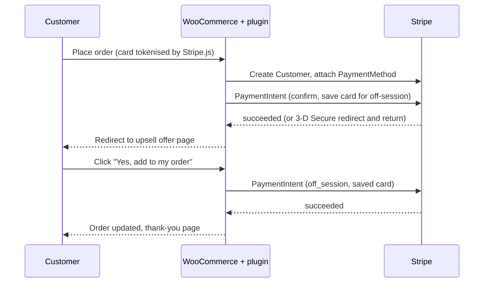

# One-Click Upsell Checkout for WooCommerce

A WooCommerce plugin that adds a **Stripe card checkout**, a **first-order discount**, and a **one-click post-purchase upsell**. After paying, the customer sees an offer page; one click charges the card they just used, with no second card entry, and adds the product to the same order.

> Portfolio / demo project written from scratch. It is not client code.

## Features

- **Stripe checkout** on the classic WooCommerce checkout (card field via Stripe.js, no card data touches your server)
- **Card saved for later** (`setup_future_usage=off_session`) so the upsell can be charged without the customer being present
- **3-D Secure** supported on the first payment (redirect and return flow)
- **One-click upsell page** with a configurable simple product and discount percentage
- **First-order discount**: percentage off the cart for customers with no earlier paid order (matched by account, or by billing email for guests)
- **Safe by design**
  - Nonce and order-key checks on the offer page
  - Upsell can be accepted only once per order (lock + Stripe idempotency key)
  - Amount is calculated on the server, including tax; the customer never sends a price
  - If the upsell charge fails, the product is removed from the order again and the original order is untouched
  - Stock is reduced for the upsell item and restored if the order is cancelled or refunded
- Compatible with **HPOS** (High-Performance Order Storage)

## How it works



## Requirements

- WordPress 6.0+, PHP 7.4+
- WooCommerce (classic shortcode checkout)
- A Stripe account (free; test mode needs no verification)

## Installation

1. Copy the `wc-oneclick-upsell` folder to `wp-content/plugins/`, or upload the zip under *Plugins > Add New > Upload*.
2. Activate **One-Click Upsell Checkout for WooCommerce**.
3. Go to *WooCommerce > Settings > Payments > Stripe (One-Click Upsell)*.
4. Enable it, keep **Test mode** on, and paste your Stripe **test** publishable and secret keys (Stripe Dashboard > Developers > API keys).
5. Optional: set a **first-order discount**, an **upsell product ID** (a simple product), and an **upsell discount**.

## Testing

| Card number | Result |
|---|---|
| `4242 4242 4242 4242` | Payment succeeds, upsell works |
| `4000 0025 0000 3155` | Asks for 3-D Secure authentication |

Use any future expiry date and any CVC. Then check:

1. Place an order and confirm you land on the offer page.
2. Click "Yes": the order gets the new line item, an order note, and a second charge in the Stripe dashboard.
3. Place a second order with the same email: the first-order discount should no longer apply.

## Project structure

```
wc-oneclick-upsell/
├── wc-oneclick-upsell.php               # bootstrap, HPOS declaration
├── includes/
│   ├── class-ocu-gateway.php            # Stripe gateway + settings + 3-D Secure return
│   ├── class-ocu-stripe-api.php         # small Stripe REST client (no SDK)
│   ├── class-ocu-upsell.php             # offer page + off-session charge + rollback
│   └── class-ocu-first-order-discount.php
└── assets/js/checkout.js                # Stripe Elements + PaymentMethod creation
```

## Known limitations

- Works with the **classic checkout**, not the block-based checkout.
- The upsell product must be a **simple product**. Shipping is not recalculated, so it suits digital products or items shipped with the main order.
- A card that needs extra verification for an off-session charge will decline the upsell (the original order stays valid).
- No Stripe **webhooks** yet, so a payment completed outside the browser flow (for example the customer closes the tab after 3-D Secure) is not reconciled automatically.
- Refunds are done through Stripe or a WooCommerce manual refund; there is no automatic refund via the API.
- Three-decimal currencies (BHD, KWD, and similar) are not handled.

## Roadmap

- Stripe webhook endpoint (`payment_intent.succeeded`, `charge.refunded`)
- WooCommerce Blocks checkout support
- Upsell product variations and multiple offers
- Unit tests for the discount and amount calculations

## License

MIT. See [LICENSE](LICENSE).
